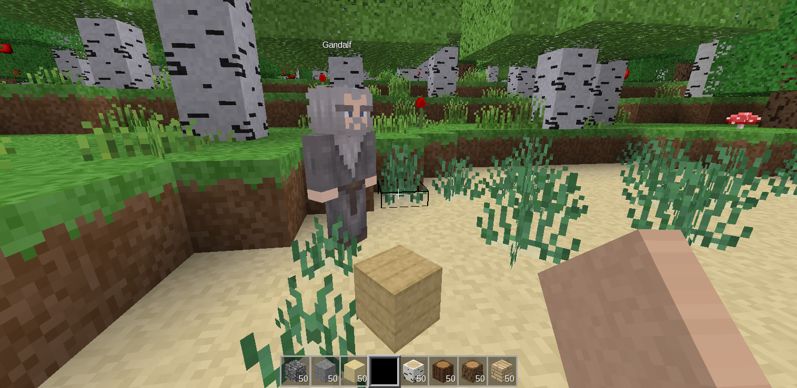

# esp32-s3-minetest

**Minetest on a $12 stick:** Minetest Game, rebuilt in Rust, running as a [Luanti](https://www.luanti.org/) server on a $12 ESP32-S3 board the size of a slightly oversized USB stick.

A standard, unmodified Luanti client connects to it over Wi-Fi as it would to any server. The board can join your access point, or run as its own free-standing hotspot. Create an account, explore a generated world, dig and build, craft, smelt, farm, sleep through the night, and play with others: it handles about six players. The world, accounts and inventories are kept on a microSD card, or, without one, in the board's own flash, and the board's small LCD shows the server's status. The same code also builds as an ordinary program for a PC or a VPS.

**Why "minetest" and not "luanti"?** When Minetest became Luanti, the point was to separate the engine (Luanti) from the game (Minetest Game). This project is really the other half: the server doesn't run Lua and can't load games or mods. It speaks Luanti's network protocol so that a normal client can connect, and everything else is Minetest Game, built in, in Rust. (It was first called esp32-s3-luanti; the old GitHub link redirects here.)

<p align="center">
  
  
  
</p>

*The server on a Waveshare ESP32-S3-LCD-1.47, showing its overview, device and chat pages.*



## What it does

It covers most of Minetest Game: 29 of its 34 mods, with boats, carts, butterflies, fireflies and creative mode still to come. The highlights (all of it is in [docs/features.md](docs/features.md)):

- **[The world](docs/features.md#the-world):** Minetest Game's biomes, from desert and savanna to tundra and icesheet, with hills, mountains, rivers, lakes, caves, lava, ores and dungeons with loot chests; day and night, weather, and fire that spreads (within limits the board can manage).
- **[Trees, plants and farming](docs/features.md#trees-plants-and-farming):** forests that grow back from saplings, flowers, bushes, kelp and corals, grass that spreads, and wheat and cotton to farm.
- **[Crafting and smelting](docs/features.md#crafting-and-smelting):** Minetest Game's recipes and furnace, with its in-game crafting guide.
- **[Building](docs/features.md#building):** stairs and slabs, doors and trapdoors, fences, walls, glass panes, chests, signs.
- **[Tools and items](docs/features.md#tools-and-items):** tools that wear, torches that light caves, flint and steel, TNT and gunpowder (with a switch for moderators), buckets, keys, the screwdriver, binoculars and the mapping kit, books you can write in.
- **[Mobs](docs/features.md#mobs):** optional, and our own (Minetest Game has none): mosslings that hunt in packs at night, and wisps that drift up and burst, off until an admin turns them on.
- **[Players](docs/features.md#players):** skins (add your own), health, drowning, bones, beds and respawn points, dropped items, Minetest Game's sounds.
- **[The server](docs/features.md#the-server):** Luanti's protocol (5.17, protocol 53), SRP logins, chat with Luanti's [commands and privileges](docs/admin.md), saving as it goes so pulling the plug loses at most a few seconds.
- **[The board](docs/features.md#the-board):** status pages on the LCD, and a status light.

How it differs from a real Luanti server: no Lua mods (the game is built in), one world per SD card, six players at once on the board (15 by default on a PC), and only Luanti 5.17 clients have been tested. See [What doesn't (yet)](docs/features.md#what-doesnt-yet) for what's still missing, and [What won't be done](docs/features.md#what-wont-be-done).

## Quick start

You need a [supported board](docs/hardware.md) (the Waveshare ESP32-S3-LCD-1.47, or LCDwiki's ES3C28P / ES3N28P), a USB cable, and optionally a microSD card formatted as FAT32.

1. Install the Rust toolchain for the ESP32 and the flashing tools (details in [docs/building.md](docs/building.md)):
   ```
   cargo install espup ldproxy espflash
   espup install
   . ~/export-esp.sh
   ```
2. Build and flash, with your Wi-Fi details (add `BOARD=es3c28p` for the LCDwiki board). The first build is slow.
   ```
   WIFI_SSID='your network' WIFI_PASS='your password' cargo run --release
   ```
3. In Luanti, open **Join Game**, enter the address the board's screen shows, port 30000, and pick a name and password. The first player to log in becomes the administrator, so make that you.

No Wi-Fi to join? Hold BOOT when the screen asks, just after switching on, and the board makes [its own hotspot](docs/setup.md#its-own-hotspot).

## On a PC or VPS

The same server builds for Linux with stable Rust, no ESP32 tools needed:

```
cd pc
cargo build --release
```

See [docs/pc.md](docs/pc.md) for the options and running it as a service.

## Documentation

- [Features](docs/features.md): everything the server does, and what it doesn't yet.
- [Hardware](docs/hardware.md): the boards, their pins, and adding another.
- [Building and flashing](docs/building.md): the toolchain, configuration, and build options (starting afresh, the test kit).
- [Setting up and connecting](docs/setup.md): the SD card or flash, Wi-Fi networks, the hotspot, the welcome message, extra media and skins.
- [Running on a PC or VPS](docs/pc.md)
- [Administrator and privileges](docs/admin.md): the chat commands.
- [Development](docs/development.md): the project layout, testing, load testing and notes for hackers. The tests have their own [README](tests/README.md).
- [Licences](docs/licences.md): the code's and the media's.

## Licence

The code is MIT, except the files translated from Luanti's or Minetest Game's own code, which keep their LGPL 2.1 or later. The media from Minetest Game are under CC BY-SA 3.0 and its other licences. [docs/licences.md](docs/licences.md) has the details and the credits.

Luanti is a trademark of its respective owners. This project is not affiliated with the Luanti project.
